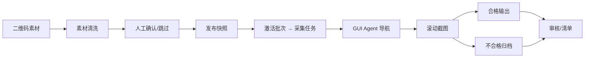

# GUI Agent 菜单自动采集系统

用 GUI Agent 打开微信里的商家小程序，确认菜单可采集后，交给 UiPath / 本地桌面驱动滚动截图；
控制台负责素材清洗、批次发布、任务调度、结果审核与不合格清单。macOS 与 Windows 共用同一套业务流程。

> 当前状态：macOS 链路稳定运行；Windows 桌面链路处于实机验收阶段，建议先按「快速开始」跑通单店再批量。

## 目录

- [项目简介](#项目简介)
- [核心能力](#核心能力)
- [系统架构](#系统架构)
- [快速开始](#快速开始)
- [使用流程](#使用流程)
- [目录结构](#目录结构)
- [开发与验证](#开发与验证)
- [运行边界](#运行边界)
- [文档索引](#文档索引)

## 项目简介

门店二维码素材先经过本地清洗与人工确认，再发布为不可变快照。激活批次后，系统为每家门店生成采集任务：
GUI Agent 在微信中打开对应小程序、导航到菜单页并交接；滚动截图由 UiPath（macOS）或 Win32 驱动（Windows）执行。
结果按批次与门店归档，异常门店进入待检查/不合格清单，可撤销、重跑或人工修复。

二维码只保存载荷哈希，不保留原文；Agent 不核对店名、不接触二维码原图。

## 核心能力

| 能力 | 说明 |
| --- | --- |
| 素材清洗 | 本地二维码检测 + 用途分类 + 人工确认/跳过，发布快照不可变。 |
| 批次管理 | 批次阶段（未采集/首轮已跑/已重跑/人工审核通过）自动维护，支持人工覆盖；软删除与回收站。 |
| 采集执行 | GUI Agent 导航与交接校验，滚动截图、菜单语义与「到底」判定，失败码分流。 |
| 结果审核 | 待检查清单跨批次筛选与批量重跑；不合格清单统一汇总、可撤销/重采集、支持 Excel 导出。 |
| 任务中心 | 素材分析与采集运行共用入口，独立页面查看历史任务与运行详情。 |
| 无人值守 | 串行自动流水线：分析 → 接受推荐 → 发布 → 激活 → 采集；单批超过 100 家自动分轮续跑。 |

## 系统架构



完整目录与模块职责见 [项目导航](docs/PROJECT_MAP.md)。

## 快速开始

### macOS

准备 macOS、Python 3.12、[uv](https://docs.astral.sh/uv/)、Node.js 22.17.1 或更新版本，以及已登录的微信和 UiPath CLI。
按 UiPath 工程要求授予辅助功能与屏幕录制权限。

```sh
cd UFS_Menu_Scraper/macos_runner
uv sync --frozen --python 3.12
npm ci --prefix ui_tars
.venv/bin/python -m menu_capture.server
```

打开 [本机控制台](http://127.0.0.1:8765/)。在设置页配置百炼北京地域的 OpenAI 兼容接口、模型名和密钥，
再通过环境诊断检查连接与桌面权限。使用自动扫码模式前，需完成 UiPath 窗口和坐标校准，并将微信停在文件传输助手。

### Windows

在已登录、未锁屏的 Windows 桌面准备微信、UiPath Studio/Assistant、UiPath CLI、uv 和 Node.js 22.17.1+。
微信 OCR 与自动扫码需要 Tesseract，并安装 `chi_sim`、`eng` 语言数据：将 `tesseract.exe` 加入 PATH，
或把 `TESSERACT_CMD` 设为其绝对路径（可用 `tesseract --list-langs` 检查）。

```powershell
Set-Location UFS_Menu_Scraper/macos_runner
.\启动菜单采集.ps1
```

配置模型与本机输入/输出目录。Windows 的选择器、快捷键与校准数据保存在 `uipath.windows.profile.json`。
先手动打开一个微信小程序，用工作台的单店接管方式验证截图、点击、菜单交接与滚动采集；
再录制微信主窗口与图片预览的选择器、校准聊天输入区，最后测试自动扫码与批量续跑。

Windows 验收建议：先在单屏 100% 缩放完成单店，再测 125%/150% 缩放的截图与点击落点；
最后用同一批素材在两端验证扫码、菜单输出与失败后的安全收尾。

## 使用流程

1. **素材清洗**：上传或指定原图目录创建批次，运行分析；逐店确认候选二维码或标记跳过。
2. **发布与激活**：发布快照后激活批次，系统按快照生成采集任务。
3. **选择任务**：在总览页选择要采集的门店（可全选或按批次筛选）。
4. **自动采集**：启动后由 GUI Agent 导航、UiPath/本地驱动截图，任务状态实时回写。
5. **审核结果**：在待检查清单重跑异常门店；在不合格清单撤销误判或重新采集。
6. **批量无人值守**（可选）：

   ```sh
   .venv/bin/python -m menu_capture.auto_pipeline --batches <batch_id> [<batch_id> ...]
   ```

   流水线按传入顺序串行执行，前一批未结束不会启动下一批；单批超过 100 家时分轮续跑。

## 目录结构

```text
小程序截图项目/
├── UFS_Menu_Scraper/macos_runner/   # 主工程：后端、前端、测试、Agent 适配
│   ├── menu_capture/                # Python 后端与采集执行
│   ├── web/                         # 控制台前端（无构建步骤）
│   ├── tests/                       # pytest 回归
│   ├── ui_tars/                     # GUI Agent SDK 适配（Node.js）
│   └── qr_detector/                 # 本地二维码检测（Node.js）
├── UFS_Menu_Capture_CrossPlatform/  # UiPath 工程（Main.xaml 等）
├── docs/                            # 开发规范、回归台账、项目导航
├── 文档/                             # PRD 与历史说明
├── 素材/                             # 规则样本、评测集、训练素材、原图
├── outputs/                         # 专项排查与验收记录（非产品代码）
└── 历史归档/                         # 旧工程与原有流程，仅作参考
```

每个关键目录与模块的职责、数据流和状态事实源见 [docs/PROJECT_MAP.md](docs/PROJECT_MAP.md)。

## 开发与验证

```sh
cd UFS_Menu_Scraper/macos_runner
.venv/bin/python -m pytest -q
```

- 涉及导航、坐标或终态的改动，需再跑隔离试验，复测问题门店与已有成功门店。
- 独立核对 Agent 最后看到的截图、执行动作与最终采集页，按实际可用菜单计算有效处理率。
- 数据库、并发与桌面链路改动需做集成验证，不以单元测试代替实机验收。

## 运行边界

- 生产数据只读排查：未经授权不清空、不覆盖、不修改正式批次与产物。
- 页面不可采结论必须来自明确证据；无法判断时进入待检查，不伪装成成功或业务结论。
- 发布快照不可变；批次改名或切换版本不会移动已产出的门店结果。
- 密钥只保存在 `secrets.local.json`，连同本机配置与运行期数据都不要提交。

## 文档索引

| 文档 | 用途 |
| --- | --- |
| [项目导航](docs/PROJECT_MAP.md) | 目录、模块职责、数据流与状态事实源。 |
| [长期开发与优化规范](docs/gui-agent-development.md) | Agent 决策权、只读边界、成功交接条件与回归口径。 |
| [菜单采集问题与回归台账](docs/menu-capture-regression.md) | 按链路记录实跑问题、复测证据与版本对照。 |
| [GUI Agent 联调说明](UFS_Menu_Scraper/macos_runner/ui_tars/README.md) | 模型配置、坐标协议、实机探测与隔离试验。 |
| [UiPath Main.xaml](UFS_Menu_Capture_CrossPlatform/Main.xaml) | 窗口发现、截图、点击与滚动等桌面操作。 |
| [首版 PRD](<文档/微信小程序菜单导航 Agent PRD.md>) | 早期试验的范围、背景与设计记录。 |
