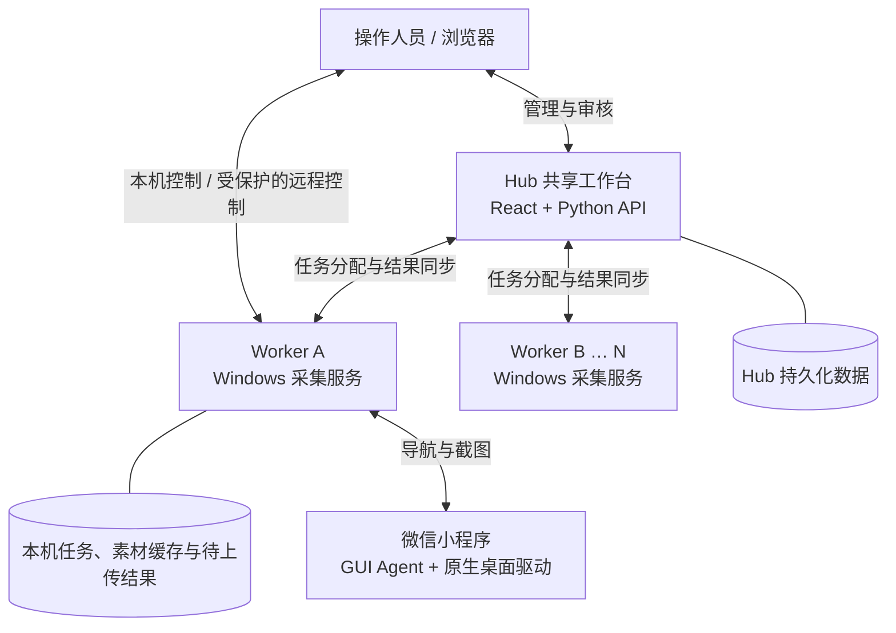
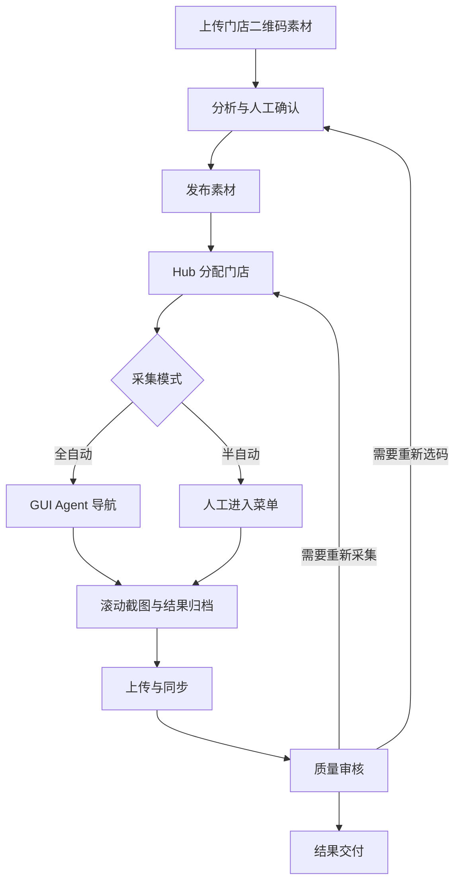

<p align="center">
  
</p>

# 菜单智能采集工作台 · Menu Capture Workbench

面向餐饮菜单批量采集的桌面自动化与多设备协作系统。将门店二维码素材、微信小程序菜单截图、任务调度和质量审核纳入同一工作流，支持集中管理、分布式执行与结果追溯。

**React · TypeScript · Python · GUI Agent · Windows · Docker**

[快速开始](#快速开始) · [核心功能](#核心功能) · [系统架构](#系统架构) · [部署指南](deploy/README.md) · [生产交付报告](docs/react-migration/production-delivery-report.md) · [版本发布](../../releases)

> 当前分支为 React 新版本交付分支。新增能力以实际代码为准。`0.2.0-rc.3` 已完成安装、升级、回滚及单台现场采集验收，并已切换生产环境；验收详情见 [生产交付报告](docs/react-migration/production-delivery-report.md)。

## 产品预览

系统由共享工作台（Hub）和 Windows 采集端（Worker）组成，均通过浏览器操作。

| 共享工作台（Hub） | 采集端（Worker） |
| --- | --- |
| 素材清洗、批次与素材发布 | 全自动 / 半自动菜单采集 |
| 采集电脑管理与任务分配 | 本机采集队列、进度与同步状态 |
| 质量审核与异常返工 | 人工标注与环境诊断 |
| 多设备任务历史查询 | 本机任务历史与远程采集控制 |

[共享工作台界面](docs/react-migration/verify/final/final-hub-workbench.jpg) · [采集端同步界面](docs/react-migration/verify/final/final-worker-sync.jpg) · [人工标注界面](docs/react-migration/verify/final/final-worker-annotation.jpg)

以上为 React 迁移阶段的浏览器验收截图。生产版本 `0.2.0-rc.3` 切换后的实机界面见 [生产工作台截图](docs/react-migration/screenshots/release/prod-rc3-workbench.jpg)。

## 核心功能

| 模块 | 能力 |
| --- | --- |
| 素材清洗 | 二维码识别、用途分析、人工选码、批次发布及素材返工。 |
| 采集执行 | GUI Agent 自主导航至菜单，全自动或半自动采集，Windows 原生桌面驱动执行滚动截图。 |
| 共享调度 | 设备配对、门店分配、回收与重新分配；已下载并校验的任务可离线处理。 |
| 质量审核 | 逐店查看采集结果，处理待检查与不合格记录，按业务规则撤销、重采或打回素材清洗。 |
| 任务中心 | 查看素材分析和采集任务、运行进度、逐店结果与历史；Hub 汇总已同步的采集端记录。 |
| 远程辅助 | 操作者通过受保护的内网 HTTPS 页面控制半自动截图及不合格确认；兼容浏览器可打开文档画中画控制窗。 |
| 设置与诊断 | 设备连接、同步状态、模型配置、用量统计与运行环境检查。 |

本轮候选版的通知提醒、连续处理、图片交互与其他体验增强事项见 [#26 产品成熟度优化](../../issues/26)。功能是否正式可用以发布验收结果为准。

## 系统架构



- **Hub**：集中管理素材、任务分配、设备、审核及已同步的历史数据，可通过 Docker Compose 部署。
- **Worker**：在已登录微信的 Windows 交互桌面执行任务，保留本机缓存及待上传结果；连接恢复后同步。
- **浏览器**：统一 React 界面。远程桌面负责人工操作微信，远程控制页面只负责发起当前半自动任务的操作。
- **GUI Agent**：负责菜单导航与业务终态判断；实际桌面执行、截图归档和任务状态管理由采集服务负责。

Hub 与 Worker 可以部署于同一台机器，也可以分布在多台机器。实际并发能力取决于设备、网络与桌面环境。

## 业务流程



无法确认菜单或采集结果时保留待检查状态，不将不确定结果当作成功。素材版本、采集轮次、分配与审核结果各自保留业务身份，具体规则见 [#20 门店级素材版本与采集状态](../../issues/20)。

## 快速开始

### 1. 部署共享工作台（Hub）

准备 Docker 和 Docker Compose。在仓库根目录将 `deploy/.env.example` 复制为 `deploy/.env`，配置管理员口令和允许访问的主机，再运行：

```bash
docker compose --env-file deploy/.env -f deploy/compose.yaml up -d --build --wait
```

正式部署请使用对应发布版本及其构建产物，并按 [部署指南](deploy/README.md) 配置受信任的内网访问、持久化数据卷与鉴权。

### 2. 安装 Windows 采集端（Worker）

1. 在 [Releases](../../releases) 下载已批准版本的 Windows x64 安装包 `MenuCapture-Setup-<版本>-win-x64.exe`。
2. 安装后从开始菜单打开「菜单采集工作台」；登录微信，在环境诊断中检查桌面、截图与 OCR。
3. 在 Hub 的「采集电脑」生成配对码，在 Worker 输入共享工作台地址、设备名称及配对码。
4. 需要全自动采集时，在执行端设置受支持的 GUI 模型及密钥。

### 3. 完成首次采集

在 Hub 创建素材批次，分析并确认二维码，发布后选择门店并分配至目标 Worker。确认任务已经下载，再启动全自动或半自动采集。先验证一家门店的截图、同步与审核结果，再扩大采集范围。

### 4. 使用远程半自动控制（可选）

在个人电脑上通过远程桌面操作 Windows 微信，并通过浏览器访问配置了可信 HTTPS 与操作员认证的 Worker `/remote-control` 页面。

进入菜单后点击「开始截图」；不能采集的门店按实际情况确认不合格。兼容的 Chromium 浏览器可由用户主动打开文档画中画窗口，实现跨应用置顶。该窗口关闭不等于停止采集。

远程控制默认不应公开暴露 Worker；配置方式、认证要求及浏览器限制见 [Windows 半自动远程控制](deploy/README.md#windows-半自动远程控制)。

## 技术栈

| 层级 | 技术 |
| --- | --- |
| Web 前端 | React 19、TypeScript、Vite、Tailwind CSS 4、OpenAI Apps SDK UI、TanStack Query |
| 后端与任务管理 | Python 3.12、FastAPI、SQLite |
| 智能导航 | GUI Agent SDK、兼容视觉模型接口 |
| Windows 桌面执行 | Win32 窗口操作、截图与输入，结合本地 OCR 和二维码检测 |
| 发布与部署 | Windows 安装包、Docker Compose、GitHub Actions |

React 前端统一构建为静态资源，由后端服务提供；业务界面不依赖外部 CDN。GUI Agent 的 Node.js 运行时依赖与前端构建依赖应区分。

## 项目结构

```text
.
├── UFS_Menu_Scraper/macos_runner/
│   ├── menu_capture/      # Python 服务、任务状态、采集与同步
│   ├── web-react/         # React + TypeScript 前端源码
│   ├── web/react/         # Vite 构建产物
│   ├── ui_tars/           # GUI Agent SDK 适配
│   ├── qr_detector/       # 二维码检测
│   └── tests/             # 后端与业务契约测试
├── deploy/                # Hub 部署、Windows 构建、升级与回滚
├── docs/                  # 架构、工程规范及验收记录
├── AGENTS.md              # 仓库协作规范
└── README.md
```

主工程保留历史目录名 `macos_runner`，不代表当前以 macOS 作为正式采集平台。历史 macOS、UiPath 与 Vue 实现不作为本轮新版本的主要部署和前端开发入口。

## 开发与验证

开发需要 Python 3.12、[uv](https://docs.astral.sh/uv/) 和与项目锁文件兼容的 Node.js / npm 环境。

在主工程目录初始化后端及 Agent 依赖：

```bash
cd UFS_Menu_Scraper/macos_runner
uv sync --frozen --python 3.12
npm ci --prefix ui_tars
uv run pytest -q
```

在同一主工程目录构建与验证前端：

```bash
cd web-react
npm ci
npm run typecheck
npm test
npm run build
```

前端构建产物位于 `web/react/`。本地开发服务可使用 `npm run dev`；启动完整业务服务前应按角色配置和部署指南准备后端环境。

自动化测试不能替代真实 Windows 桌面验证。涉及导航、数据模型、同步及发布的修改，应按实际影响执行相应契约测试和现场回归。

## 版本、升级与回滚

- **Windows**：安装包按版本目录并存，使用安装目录中的 `rollback.ps1` 回退到已保留的版本。升级前确认采集及标注空闲，并备份运行数据。
- **Hub**：通过明确的镜像版本标签升级或回退，保留持久化数据卷；首次迁移须先用副本验证数据兼容性。
- **版本核对**：新版本提供 `/api/version`，用于核对运行版本与前端构建入口；迁移前版本需使用相应的兼容验证方式。

完整操作、旧数据迁移及验收步骤见 [部署与回滚指南](deploy/README.md)。`0.2.0-rc.3` 已于 2026-11-24 完成本机 `0.1.2 → 0.2.0-rc.3 → 0.1.2` 安装、升级、回滚 smoketest 并切换生产；详见 [生产交付报告](docs/react-migration/production-delivery-report.md)。

## 文档与维护

| 文档 | 用途 |
| --- | --- |
| [部署指南](deploy/README.md) | 安装、设备配对、内网访问、升级、回滚与数据迁移。 |
| [项目导航](docs/PROJECT_MAP.md) | 既有模块职责及数据流参考；历史技术描述以当前代码为准。 |
| [开发与优化规范](docs/gui-agent-development.md) | Agent 决策权、业务边界与回归口径。 |
| [问题与回归台账](docs/menu-capture-regression.md) | 采集问题及复测记录。 |
| [React 迁移报告](docs/react-migration/final-migration-report.md) | 迁移阶段的技术架构、测试和已知限制。 |
| [生产交付报告](docs/react-migration/production-delivery-report.md) | 生产验收结论、测试证据、上线与回滚方案。 |
| [工程规范](docs/engineering-standards.md) | 分层职责、测试矩阵、静态检查与 CI 门禁。 |
| [变更记录](CHANGELOG.md) | 各版本范围与升级回滚要点。 |
| [贡献指南](CONTRIBUTING.md) · [安全策略](SECURITY.md) | 开发流程、提交规范与凭据处理要求。 |
| [仓库协作规范](AGENTS.md) | 开发协作及交接要求。 |
| [历史文档归档](docs/archive/README.md) | 已归档阶段需求与实施记录。 |
| [Issues](../../issues) · [Releases](../../releases) | 需求、缺陷、发布记录与安装产物。 |

## 安全与运行边界

- 仅采集有权访问且符合相关平台规则的菜单；遇到访问限制或无法判断的页面，按实际业务结果处理。
- 不将模型密钥、认证令牌、客户素材、真实门店数据、运行数据库或未脱敏的诊断记录提交到公开仓库。
- 生产数据未经授权不得清空、覆盖或修改；升级及迁移先备份，避免干扰正在运行的任务。
- Windows 执行端需要可用的交互桌面与微信登录状态；全自动导航还依赖模型服务。远程控制不代表可以脱离这些运行条件。
