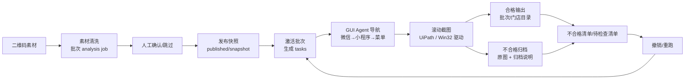

# 项目导航（PROJECT_MAP）

本文件回答三个问题：**这个仓库由哪些部分组成、每个目录/模块负责什么、一次采集的数据如何流动**。
新同学建议按 `README.md` → 本文件 → [长期开发与优化规范](gui-agent-development.md) 的顺序阅读。

## 1. 系统定位

GUI Agent 负责在微信里打开商家小程序并导航到可滚动的菜单页；交接后由 UiPath / 本地桌面驱动滚动截图；
控制台负责素材清洗、批次发布、任务调度、结果审核与不合格清单。



## 2. 顶层目录

| 目录/文件 | 作用 |
| --- | --- |
| `UFS_Menu_Scraper/macos_runner/` | 主工程：Python 后端、Web 控制台、GUI Agent 适配、测试与本地配置。 |
| `UFS_Menu_Capture_CrossPlatform/` | UiPath 工程（`Main.xaml` 等），执行窗口发现、截图、点击、滚动等桌面动作。 |
| `docs/` | 长期开发规范、回归台账与本导航。 |
| `文档/` | PRD、会议纪要、历史说明等背景资料（非运行依赖）。 |
| `素材/` | 规则样本、评测集、训练素材、原图等输入数据。 |
| `outputs/` | 历次专项排查/验收的过程脚本与结论，不是产品代码。 |
| `历史归档/` | 旧 UiPath 工程与原有流程，仅作参考，不参与当前运行。 |
| `spec.md` / `tasks.md` | 单次专项（“只截 1-3 页”）的问题证据与执行清单，属于过程记录。 |
| `AGENTS.md` | 仓库协作规则（含每轮工作日志要求）。 |

## 3. macos_runner 目录

```text
macos_runner/
├── menu_capture/        # Python 后端与采集执行
├── web/                 # 控制台前端（无构建步骤，服务直接读取）
├── tests/               # pytest 回归
├── ui_tars/             # GUI Agent SDK 适配（Node.js）
├── qr_detector/         # 本地二维码检测（Node.js）
├── scripts/             # 运维/数据修复脚本
├── data/                # 任务库、素材库、调试日志（运行期数据）
├── output/              # 默认输出目录（可被配置覆盖）
├── 启动菜单采集.command  # macOS 启动入口
├── 启动菜单采集.ps1      # Windows 启动入口
├── config.local.json    # 本机配置（不含密钥）
└── secrets.local.json   # 密钥（不入库）
```

## 4. 后端模块（`menu_capture/`）

### 4.1 入口、配置与运行环境

| 模块 | 职责 |
| --- | --- |
| `server.py` | FastAPI 应用：REST 路由、令牌校验、静态资源；只做协议层，业务下沉到各 service。 |
| `service.py` | 把 Web 服务托管给当前用户（macOS LaunchAgent），不自动启动采集。 |
| `config.py` | `Settings` 校验与本地 JSON 原子读写；普通配置与密钥分离。 |
| `instance_lock.py` | 单实例锁：同一台机器只允许一个服务占用桌面任务。 |
| `connections.py` | 连接生命周期：模型/桌面探针事实的缓存、恢复与展示状态。 |
| `environment.py` | 环境诊断：依赖、权限、OCR、路径等检查项。 |
| `debug_log.py` | 调试日志：分段 JSONL、异步写入与容量清理。 |

### 4.2 任务、运行与用量

| 模块 | 职责 |
| --- | --- |
| `store.py` | SQLite 唯一事实源：`tasks`、`runs`、`run_actions`、`events`；状态迁移与幂等迁移。 |
| `robot_profile.py` | UiPath 运行配置：选择器、快捷键、窗口尺寸、坐标校准。 |
| `model_usage.py` | 模型调用用量台账与按日统计。 |
| `model.py` | 视觉模型客户端（OpenAI 兼容接口）与 JSON 结果解析。 |

### 4.3 素材清洗与批次

| 模块 | 职责 |
| --- | --- |
| `materials.py` | 素材批次、分析结果、人工决策、发布快照与批次阶段。 |
| `material_jobs.py` | 分析 job 的持久化与并发调度；状态迁移用单条 UPDATE 做 CAS。 |
| `material_fallback.py` | 对本地检测漏检图片做保守的视觉补检。 |
| `material_versions.py` | 发布版本元数据；清洗决策与不可变发布清单分开保存。 |
| `preprocess.py` | 本地二维码素材预筛，只保存载荷哈希，不保留原文。 |
| `purpose_classifier.py` | 二维码用途视觉分类（点餐码/收款码等），不接触解码载荷。 |
| `batch_management.py` | 批次列表、软删除/恢复、物理清理与删除前置校验。 |
| `capture_outputs.py` | 产物目录命名、门店目录、不合格原图归档。 |

### 4.4 采集执行与桌面能力

| 模块 | 职责 |
| --- | --- |
| `uipath_runner.py` | 单店采集主流程：准备微信、导航交接、滚动截图、菜单校验、结果落库与归档。 |
| `ui_tars_trial.py` | GUI Agent SDK 子进程协议、动作白名单、目标 ID 与坐标契约。 |
| `scene_agent.py` | 单步场景决策：根据当前画面输出点击/滚动/等待/就绪/阻塞等动作与理由。 |
| `uipath_cli.py` | 定位本机 UiPath CLI 并组装可直接执行的参数。 |
| `window_contract.py` | 动作回执中的窗口身份契约（与像素内容验证分离）。 |
| `windows_desktop.py` | Windows Win32 桌面驱动：窗口级截图、点击、输入（适配 `WeChatAppEx.exe`）。 |
| `windows_image.py` | Windows 本地 OCR、二维码识别与剪贴板适配。 |
| `macos.py` | macOS 原生能力：权限查询、Vision OCR、二维码定位。 |
| `image_tools.py` | 已保存图片与剪贴板的图像处理，不读取桌面、不注入输入事件。 |
| `template_locator.py` | 多尺度模板匹配，定位固定 UI 控件。 |
| `preview_locator.py` | 图片预览页顶部“识别二维码”图标定位。 |
| `target_candidates.py` | 把 OCR 行转换成稳定的可点击候选 ID，模型只选 ID 不猜坐标。 |
| `chat_anchor.py` | 微信聊天截图中的店名锚点定位。 |
| `chat_layout.py` | 绿色文本气泡（已发送店名）定位。 |
| `chat_image_locator.py` | 在聊天记录中定位刚发送的图片缩略图。 |
| `checkbox_locator.py` | 协议/隐私弹窗的勾选框定位。 |
| `close_icon_locator.py` | 把模型给出的粗坐标精修到附近的关闭图标。 |

### 4.5 结果、审核与自动化

| 模块 | 职责 |
| --- | --- |
| `rejections.py` | 汇总素材决策与采集任务的不合格记录，支持筛选与 Excel 导出。 |
| `annotation.py` | 人工标注模式：只给候选，点击必须人工确认，保留前后截图样本。 |
| `auto_pipeline.py` | 串行无人值守：分析 → 接受推荐 → 发布 → 激活 → 采集，单批超 100 家自动分轮。 |

## 5. 前端（源码 `web-react/`，产物 `web/react/`）

| 路径 | 职责 |
| --- | --- |
| `web-react/src/app/` | 路由、角色边界、壳层导航与顶栏活动任务入口。 |
| `web-react/src/features/<域名>/` | 按业务域拆分的页面、弹窗、API 封装与展示格式化。 |
| `web/react/` | 提交到仓库的构建产物：`index.html`、`assets/`、`.vite/manifest.json`。 |
| `menu_capture/server.py` | `/` 返回 React 入口，`/assets/{name}` 按 manifest 白名单返回哈希资源。 |

当前页面：采集工作台（Hub 调度 / Windows 执行）、设备与分配、素材清洗、不合格、待检查、任务中心、人工标注、环境诊断、设置（含模型用量）。旧 `web/index.html`、`web/*.js|css`、Vue 试点 `web-ui/` 与 `web/vue/` 已退场。

## 6. 数据流与状态事实源

| 对象 | 存储位置 | 说明 |
| --- | --- | --- |
| 素材批次 | `material_batches` | 名称、描述、阶段、删除标记。 |
| 分析任务 | `material_jobs` / job items | 分析运行态唯一事实源，批次状态只表示结果是否可用。 |
| 清洗决策 | `material_decisions` | 确认/跳过、原因与补充说明。 |
| 发布快照 | `data/materials/published/<snapshot>` | 不可变，采集只读快照。 |
| 采集任务 | `tasks` | 状态：`pending/running/paused/captured/needs_review/needs_retry/error/blocked/...`。 |
| 采集运行 | `runs` / `run_actions` | 一次运行的任务列表、当前进度与动作证据。 |
| 批次阶段 | `material_batches.stage` | `not_started / first_run / rerun / approved`，支持人工覆盖。 |
| 不合格记录 | `material_decisions.reject_*`、`tasks.reject_*` | 清单只是汇总视图，不另建状态机。 |

产物落点：

- 合格输出：`<output_dir>/<批次名>/<门店>/`
- 运行期临时：`<output_dir 同级>/.uipath-runs`、`.uipath-staging`
- 不合格归档：配置的 `unqualified_dir/<门店>/二维码.png + 归档说明.txt`

## 7. 测试

- 全量回归：在 `macos_runner` 下执行 `.venv/bin/python -m pytest -q`
- 重点覆盖：批次管理、素材 API、任务身份、UiPath 窗口契约、失败码、待检查/不合格清单、自动流水线续跑。
- 测试不访问真实桌面、模型和网络；涉及实机链路的改动需另做单店实跑验证。

## 8. 常见任务速查

| 任务 | 入口 |
| --- | --- |
| 启动控制台（macOS） | `cd UFS_Menu_Scraper/macos_runner && .venv/bin/python -m menu_capture.server` |
| 启动控制台（Windows） | `cd UFS_Menu_Scraper/macos_runner; .\启动菜单采集.ps1` |
| 跑测试 | `.venv/bin/python -m pytest -q` |
| 无人值守批量采集 | `.venv/bin/python -m menu_capture.auto_pipeline --batches <batch_id> [...]` |
| 查看任务/运行状态 | `GET /api/status`、`GET /api/tasks/active` |
| 不合格清单 | `GET /api/rejections`、`GET /api/rejections/export.xlsx` |
| 待检查清单 | `GET /api/reviews/pending` |

## 9. 相关文档

- [README](../README.md)：项目概览与快速开始
- [长期开发与优化规范](gui-agent-development.md)：Agent 决策权、工具边界与验收口径
- [菜单采集问题与回归台账](menu-capture-regression.md)：按链路记录的问题与复测证据
- [GUI Agent 联调说明](../UFS_Menu_Scraper/macos_runner/ui_tars/README.md)：模型配置、坐标协议与隔离试验
- [微信小程序菜单导航 Agent PRD](../文档/微信小程序菜单导航%20Agent%20PRD.md)：早期范围与设计记录
