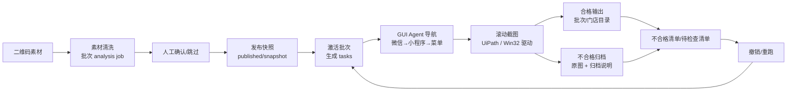

# 项目导航（PROJECT_MAP）

本文件回答三个问题：**这个仓库由哪些部分组成、每个目录/模块负责什么、一次采集的数据如何流动**。
新同学建议按 `README.md` → 本文件 → [长期开发与优化规范](gui-agent-development.md) 的顺序阅读。

## 1. 系统定位

GUI Agent 负责在微信里打开商家小程序并导航到可滚动的菜单页；交接后由 UiPath / 本地桌面驱动滚动截图；
控制台负责素材清洗、批次发布、任务调度、结果审核与不合格清单。



## 2. 顶层目录

| 目录/文件 | 作用 |
| --- | --- |
| `app/` | 主工程：Python 后端、React 控制台源码与构建产物、GUI Agent 适配、测试与本地配置。 |
| `compat/uipath/` | UiPath 工程（`Main.xaml` 等），仅在“通过 UiPath CLI 启动”方式下使用，不进入 Windows 安装包。 |
| `deploy/` | Windows 安装器、Hub 容器与发布验收脚本。 |
| `docs/` | 工程规范、项目导航、回归台账、产品需求、发布报告与历史归档。 |
| `输出/` | 采集默认输出目录（运行数据，不入库）。 |
| `.github/workflows/` | CI：前端校验、Python 回归、安装包构建、Hub 镜像与 Ruff 门禁。 |
| `AGENTS.md` | 仓库协作规则（精简版，细节见 `docs/governance/engineering-standards.md`）。 |

## 3. app 目录

```text
app/
├── menu_capture/        # Python 后端与采集执行（按域分包，见第 4 节）
├── web-react/           # React 控制台源码（Vite + TypeScript）
├── web/react/           # 构建产物，随代码提交并由 CI 校验一致
├── tests/               # pytest：unit / integration / contract / platform / fixtures
├── ui_tars/             # GUI Agent SDK 适配（Node.js）
├── qr_detector/         # 本地二维码检测（Node.js）
├── scripts/             # 运维/数据修复脚本与本地启动入口
├── data/                # 任务库、素材库、调试日志（运行期数据，不入库）
├── output/              # 历史输出目录（运行期数据，不入库）
├── 启动菜单采集.command → scripts/启动菜单采集.command  # macOS 启动入口（调试用）
├── 启动菜单采集.ps1     → scripts/启动菜单采集.ps1      # Windows 启动入口
├── config.local.json    # 本机配置（不入库）
└── secrets.local.json   # 密钥（不入库）
```

## 4. 后端模块（`menu_capture/`）

按域分包，依赖方向为 `api → capture/materials/annotation/quality/shared/updates → core/storage`，跨域只调用对方公开函数，不直接读写对方数据表。

| 包 | 职责 |
| --- | --- |
| `api/` | FastAPI 装配、HTTP 路由与页面数据接口 |
| `capture/` | 采集执行、批次调度、输出与历史 |
| `desktop/` | Windows/macOS 桌面能力、图像定位与窗口契约 |
| `vision/` | 视觉模型、场景决策、用途分类与用量 |
| `agent/` | GUI Agent 试运行与交接 |
| `materials/` | 素材清洗、发布快照与不合格返工 |
| `projects/` | 项目生命周期、稳定归属校验、批次/任务解析及项目素材选择；项目 ID 是隔离键，项目 code 用于交付路径 |
| `annotation/` | 独立标注、快捷键与目标候选 |
| `quality/` | 失败归因与质量口径 |
| `shared/` | Hub/Worker 共享状态、历史与镜像更新 |
| `storage/` | SQLite 事实源与调试日志 |
| `updates/` | 发布发现、下载、安装、回滚与清理 |
| `core/` | 配置、连接、环境诊断与单实例托管 |


### 4.1 入口、配置与运行环境

| 模块 | 职责 |
| --- | --- |
| `api/server.py` | FastAPI 应用：REST 路由、令牌校验、静态资源；只做协议层，业务下沉到各 service。 |
| `core/service.py` | 把 Web 服务托管给当前用户（macOS LaunchAgent），不自动启动采集。 |
| `core/config.py` | `Settings` 校验与本地 JSON 原子读写；普通配置与密钥分离。 |
| `core/instance_lock.py` | 单实例锁：同一台机器只允许一个服务占用桌面任务。 |
| `core/connections.py` | 连接生命周期：模型/桌面探针事实的缓存、恢复与展示状态。 |
| `core/environment.py` | 环境诊断：依赖、权限、OCR、路径等检查项。 |
| `storage/debug_log.py` | 调试日志：分段 JSONL、异步写入与容量清理。 |

### 4.2 任务、运行与用量

| 模块 | 职责 |
| --- | --- |
| `storage/store.py` | SQLite 唯一事实源：`tasks`、`runs`、`run_actions`、`events`；状态迁移与幂等迁移。 |
| `capture/robot_profile.py` | UiPath 运行配置：选择器、快捷键、窗口尺寸、坐标校准。 |
| `vision/model_usage.py` | 模型调用用量台账与按日统计。 |
| `vision/model.py` | 视觉模型客户端（OpenAI 兼容接口）与 JSON 结果解析。 |

### 4.3 素材清洗与批次

| 模块 | 职责 |
| --- | --- |
| `materials/materials.py` | 素材批次、分析结果、人工决策、发布快照与批次阶段。 |
| `materials/material_jobs.py` | 分析 job 的持久化与并发调度；状态迁移用单条 UPDATE 做 CAS。 |
| `materials/material_fallback.py` | 对本地检测漏检图片做保守的视觉补检。 |
| `materials/material_versions.py` | 发布版本元数据；清洗决策与不可变发布清单分开保存。 |
| `materials/preprocess.py` | 本地二维码素材预筛，只保存载荷哈希，不保留原文。 |
| `vision/purpose_classifier.py` | 二维码用途视觉分类（点餐码/收款码等），不接触解码载荷。 |
| `capture/batch_management.py` | 批次列表、软删除/恢复、物理清理与删除前置校验。 |
| `capture/capture_outputs.py` | 产物目录命名、门店目录、不合格原图归档。 |

### 4.4 采集执行与桌面能力

| 模块 | 职责 |
| --- | --- |
| `capture/uipath_runner.py` | 单店采集主流程：准备微信、导航交接、滚动截图、菜单校验、结果落库与归档。 |
| `agent/ui_tars_trial.py` | GUI Agent SDK 子进程协议、动作白名单、目标 ID 与坐标契约。 |
| `vision/scene_agent.py` | 单步场景决策：根据当前画面输出点击/滚动/等待/就绪/阻塞等动作与理由。 |
| `capture/uipath_cli.py` | 定位本机 UiPath CLI 并组装可直接执行的参数。 |
| `desktop/window_contract.py` | 动作回执中的窗口身份契约（与像素内容验证分离）。 |
| `capture/windows_desktop.py` | Windows Win32 桌面驱动：窗口级截图、点击、输入（适配 `WeChatAppEx.exe`）。 |
| `desktop/windows_image.py` | Windows 本地 OCR、二维码识别与剪贴板适配。 |
| `capture/macos.py` | macOS 原生能力：权限查询、Vision OCR、二维码定位。 |
| `desktop/image_tools.py` | 已保存图片与剪贴板的图像处理，不读取桌面、不注入输入事件。 |
| `desktop/template_locator.py` | 多尺度模板匹配，定位固定 UI 控件。 |
| `desktop/preview_locator.py` | 图片预览页顶部“识别二维码”图标定位。 |
| `annotation/target_candidates.py` | 把 OCR 行转换成稳定的可点击候选 ID，模型只选 ID 不猜坐标。 |
| `desktop/chat_anchor.py` | 微信聊天截图中的店名锚点定位。 |
| `desktop/chat_layout.py` | 绿色文本气泡（已发送店名）定位。 |
| `desktop/chat_image_locator.py` | 在聊天记录中定位刚发送的图片缩略图。 |
| `desktop/checkbox_locator.py` | 协议/隐私弹窗的勾选框定位。 |
| `desktop/close_icon_locator.py` | 把模型给出的粗坐标精修到附近的关闭图标。 |

### 4.5 结果、审核与自动化

| 模块 | 职责 |
| --- | --- |
| `materials/rejections.py` | 汇总素材决策与采集任务的不合格记录，支持筛选与 Excel 导出。 |
| `annotation/annotation.py` | 人工标注模式：只给候选，点击必须人工确认，保留前后截图样本。 |
| `capture/auto_pipeline.py` | 串行无人值守：分析 → 接受推荐 → 发布 → 激活 → 采集，单批超 100 家自动分轮。 |

## 5. 前端（源码 `web-react/`，产物 `web/react/`）

| 路径 | 职责 |
| --- | --- |
| `web-react/src/app/` | 路由、角色边界、壳层导航与顶栏活动任务入口。 |
| `web-react/src/features/<域名>/` | 按业务域拆分的页面、弹窗、API 封装与展示格式化。 |
| `web/react/` | 提交到仓库的构建产物：`index.html`、`assets/`、`.vite/manifest.json`。 |
| `menu_capture/server.py` | `/` 返回 React 入口，`/assets/{name}` 按 manifest 白名单返回哈希资源。 |

当前页面：采集工作台（Hub 调度 / Windows 执行）、设备与分配、素材清洗、不合格、待检查、任务中心、人工标注、环境诊断、设置（含模型用量）。旧 `web/index.html`、`web/*.js|css`、Vue 试点 `web-ui/` 与 `web/vue/` 已退场。

## 6. 数据流与状态事实源

| 对象 | 存储位置 | 说明 |
| --- | --- | --- |
| 素材批次 | `material_batches` | 名称、描述、阶段、删除标记。 |
| 分析任务 | `material_jobs` / job items | 分析运行态唯一事实源，批次状态只表示结果是否可用。 |
| 清洗决策 | `material_decisions` | 确认/跳过、原因与补充说明。 |
| 发布快照 | `data/materials/published/<snapshot>` | 不可变，采集只读快照。 |
| 采集任务 | `tasks` | 状态：`pending/running/paused/captured/needs_review/needs_retry/error/blocked/...`。 |
| 采集运行 | `runs` / `run_actions` | 一次运行的任务列表、当前进度与动作证据。 |
| 批次阶段 | `material_batches.stage` | `not_started / first_run / rerun / approved`，支持人工覆盖。 |
| 不合格记录 | `material_decisions.reject_*`、`tasks.reject_*` | 清单只是汇总视图，不另建状态机。 |

产物落点：

- 合格输出：`<output_dir>/<批次名>/<门店>/`
- Hub 派生交付视图：`<MENU_CAPTURE_DELIVERY_MOUNT>/项目/<project.code>/合格/<门店目录>/`；每项目独立索引范围。既有根目录下的旧 `合格/` 保留，不自动搬迁或删除。
- 运行期临时：`<output_dir 同级>/.uipath-runs`、`.uipath-staging`
- 不合格归档：配置的 `unqualified_dir/<门店>/二维码.png + 归档说明.txt`

### 项目隔离边界

- `projects.service` 负责稳定项目身份、旧批次到固定历史项目的迁移及统一归属解析。批次保留原 ID，不能因重名跨项目共享业务状态；历史归属不明时保持未知并待核验。
- Hub 业务查询和写操作以项目为范围，并在后端校验项目、批次、任务之间的一致归属。项目归档会阻止新业务写入；设备、配对连接及运行中的桌面执行互斥仍是实例级资源。
- Worker 仅在连接协商确认支持项目范围后交换项目字段；旧 Hub/Worker 继续使用原协议字段，单项目兼容模式不推断多项目能力。新协议严格校验项目标识，历史 outbox/分配仍按任务 ID 和既有 ACK 语义处理。
- 回滚到不识别多项目字段/数据模型的旧 Hub 前，必须由 schema compatibility guard 阻止不安全启动；此保护仍需在目标旧版二进制与实际数据库升级/回滚链路验证。

## 7. 测试

- 在 `app/` 按改动执行 `uv run --frozen pytest -q <相关测试路径>` 和 `uvx ruff check <受影响路径>`。
- 前端使用必要的 `npm run typecheck` 和 `npm test -- <相关测试文件>`，提交受影响的静态资源前再核对构建产物。
- 重点覆盖：批次管理、素材 API、任务身份、UiPath 窗口契约、失败码、待检查/不合格清单、自动流水线续跑。
- 测试不访问真实桌面、模型和网络；涉及实机链路的改动需另做单店实跑验证。

## 8. 常见任务速查

| 任务 | 入口 |
| --- | --- |
| 启动控制台（Windows） | `cd app; .\启动菜单采集.ps1` |
| 启动控制台（macOS 调试） | `cd app && .venv/bin/python -m menu_capture.api.server` |
| 跑针对性测试 | `uv run --frozen pytest -q <相关测试路径>` |
| 无人值守批量采集 | `uv run --frozen python -m menu_capture.auto_pipeline --batches <batch_id> [...]` |
| 查看任务/运行状态 | `GET /api/status`、`GET /api/tasks/active` |
| 不合格清单 | `GET /api/rejections`、`GET /api/rejections/export.xlsx` |
| 待检查清单 | `GET /api/reviews/pending` |
| 最终集成验收与打包 | 全部开发完成后按 [发布与云端构建](engineering-standards.md#发布与云端构建) 执行 |

## 9. 相关文档

- [README](../README.md)：项目概览与快速开始
- [工程规范](governance/engineering-standards.md)：分层、测试、静态检查与 CI 门禁
- [长期开发与优化规范](architecture/gui-agent-development.md)：Agent 决策权、工具边界与验收口径
- [菜单采集问题与回归台账](governance/menu-capture-regression.md)：按链路记录的问题与复测证据
- [GUI Agent 联调说明](../app/ui_tars/README.md)：模型配置、坐标协议与隔离试验
- [微信小程序菜单导航 Agent PRD](product/微信小程序菜单导航%20Agent%20PRD.md)：早期范围与设计记录
- [历史文档归档](archive/README.md)：已归档的阶段需求与实施记录
- [变更记录](../CHANGELOG.md)、[贡献指南](../CONTRIBUTING.md)、[安全策略](../SECURITY.md)
